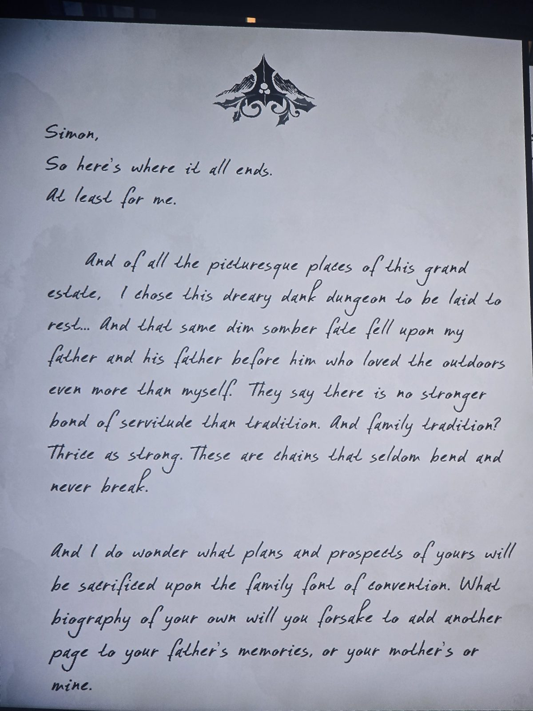
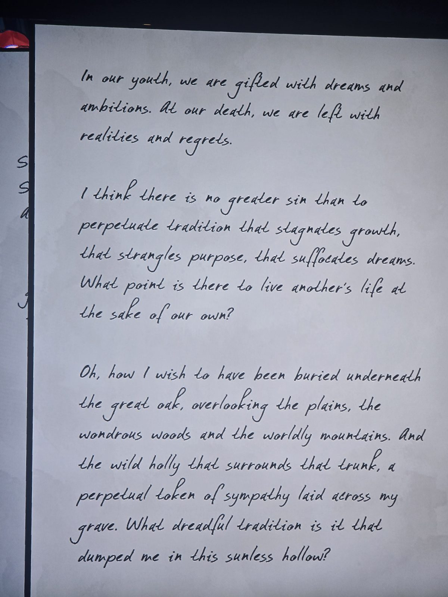
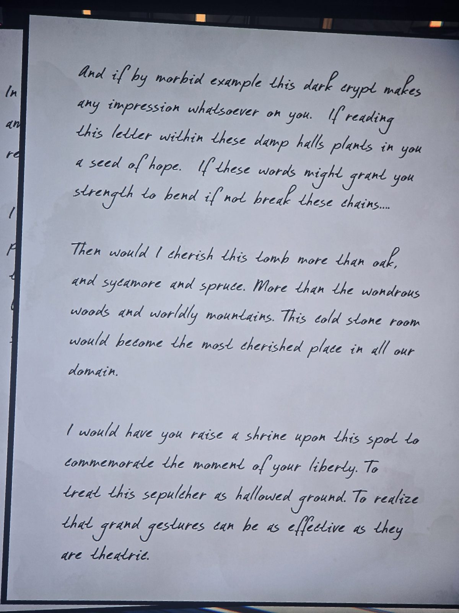
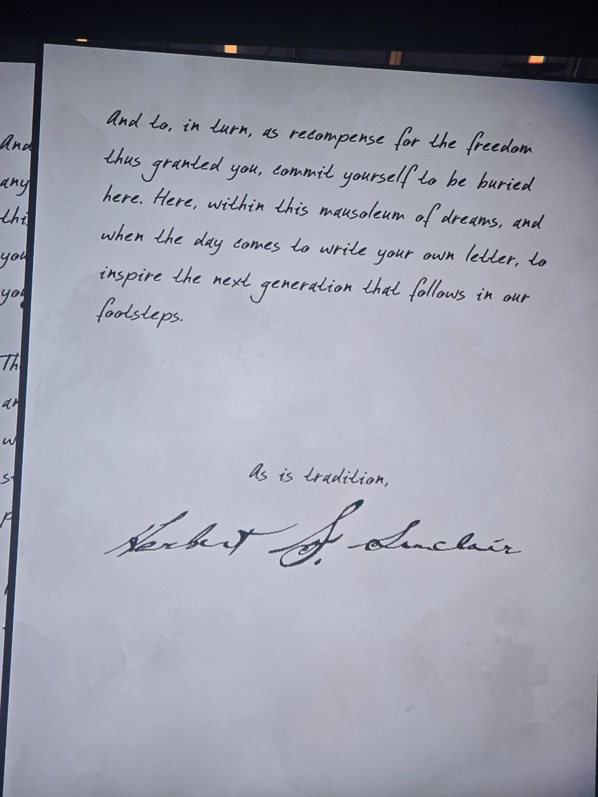

Саймон,
вот здесь всё и заканчивается. По крайней мере для меня.
Из всех живописных мест поместья я выбрал для упокоения это мрачное сырое подземелье… Ту же участь разделили мой отец и его отец, любившие природу ещё сильнее меня. Говорят, нет уз крепче традиции. А семейная традиция — втрое крепче. Это цепи, что редко гнутся и никогда не рвутся.
Интересно, какими своими планами ты пожертвуешь на алтаре условностей, чтобы дописать страницу в чужую историю — отца, матери или мою.

В юности нам дарят мечты. К смерти остаются реальность и сожаления.
Нет греха больше, чем продолжать традицию, которая душит рост, цель и мечты. Зачем жить чужой жизнью ценой своей?
Как бы я хотел лежать под **великим дубом**, глядя на равнины, чудесные леса и далёкие горы, а **дикий остролист** вокруг ствола был бы вечным знаком скорби на моей могиле. Что за жуткая традиция бросила меня в эту бессолнечную яму?

Но если этот склеп хоть как-то на тебя подействует, если письмо посеет надежду и даст силы согнуть, а то и порвать эти цепи…
Тогда я буду ценить эту гробницу больше дуба, платана и ели, больше лесов и гор. Этот холодный камень станет самым дорогим местом поместья.
Возведи здесь святилище в честь своей свободы. Считай гробницу священной землёй. Пойми, что громкие жесты бывают столь же действенны, сколь театральны.

А взамен, в уплату за дарованную свободу, завещай похоронить здесь и себя, и однажды напиши своё письмо следующему поколению.
Как велит традиция,
Герберт С. Синклер

## Photos / Фото

