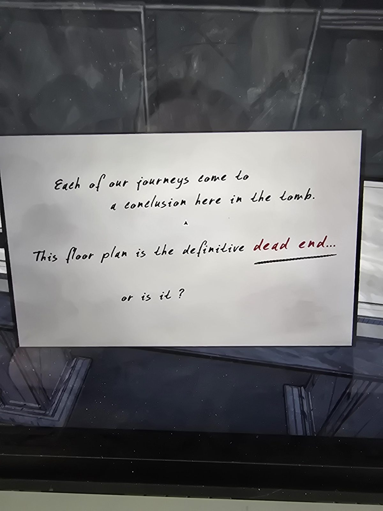

# Записка на столе (Tomb)
Записка на столе в Tomb. Слова **«dead end»** (тупик) выделены красным и подчёркнуты.

Каждое из наших путешествий приходит к завершению здесь, в гробнице.

Этот план комнаты, **окончательный тупик**…

или нет?

## Заметка
- Намёк, что в тупике есть продолжение: в Tomb есть тайный проход в Catacombs (см. [решения](../../solutions.md)).

## Photos / Фото

