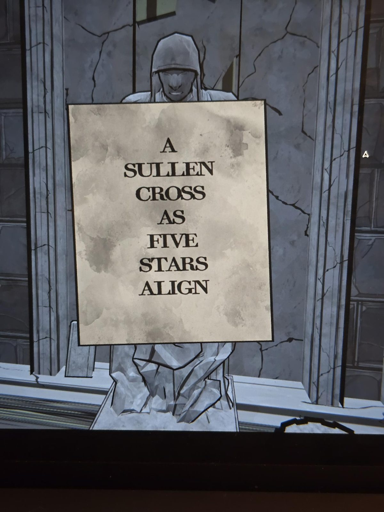
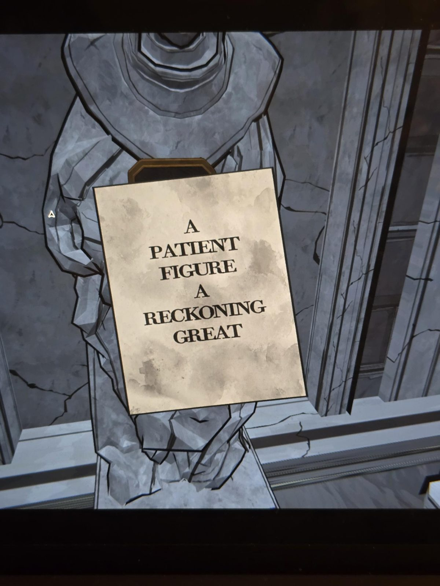
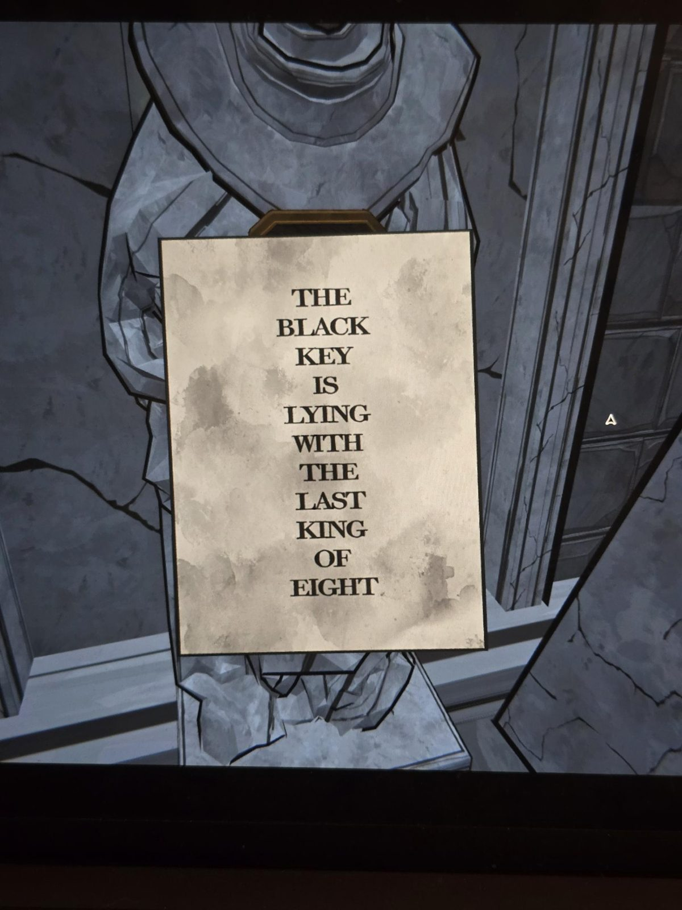

# Statue notes (Unknown)
Eight statues, each holding a Mora Jai box; in each box there was a note instead of an Allowance Token. Together the notes read as a poem (line order by rhyme and photo order).

1. IN / ARIES / COURT / WHERE / THE / KING / NOW / LAYS
2. ON / THE / SACRED / HOUR / THAT / TIMEWORN / PHRASE
3. WILL / A / YOUTH / APPROACH / WITH / EMPTY / ARMS
4. WITHOUT / GIFTS / NOR / GOLD / NOR / MANNERED / CHARMS
5. AND / IN / SKY / ABOVE / A / BRILLIANT / SIGN
6. A / SULLEN / CROSS / AS / FIVE / STARS / ALIGN
7. A / PATIENT / FIGURE / A / RECKONING / GREAT
8. THE / BLACK / KEY / IS / LYING / WITH / THE / LAST / KING / OF / EIGHT

## Photos / Фото
       
