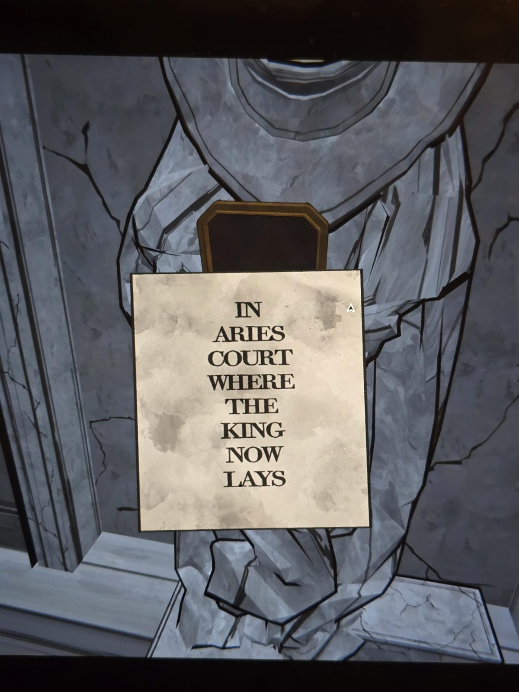
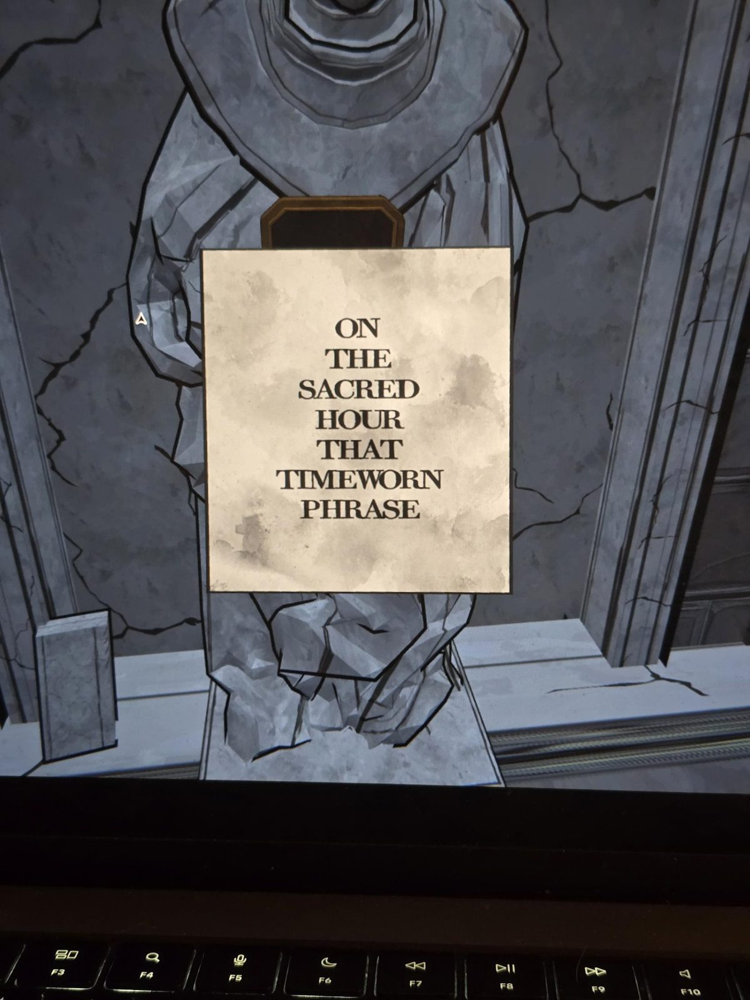
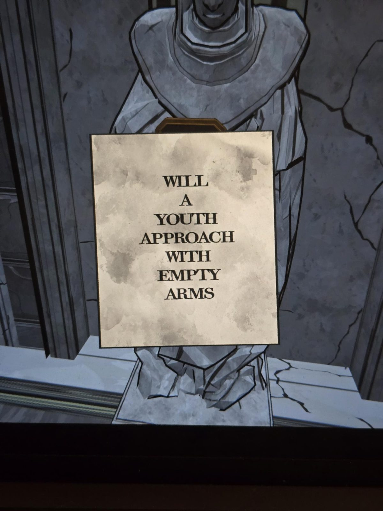
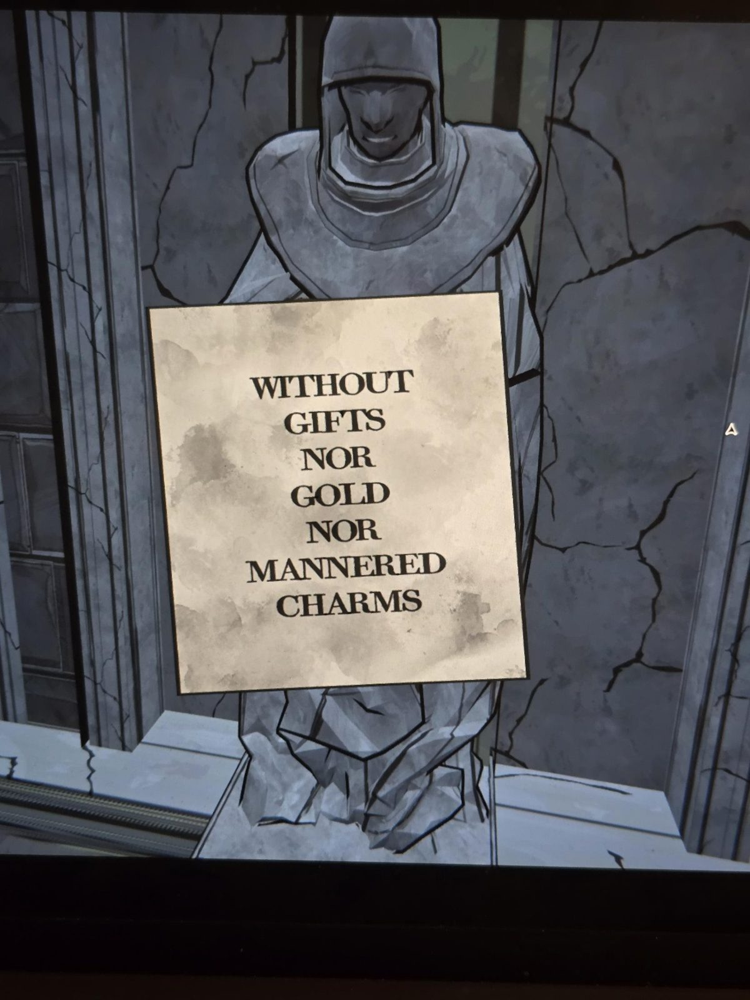
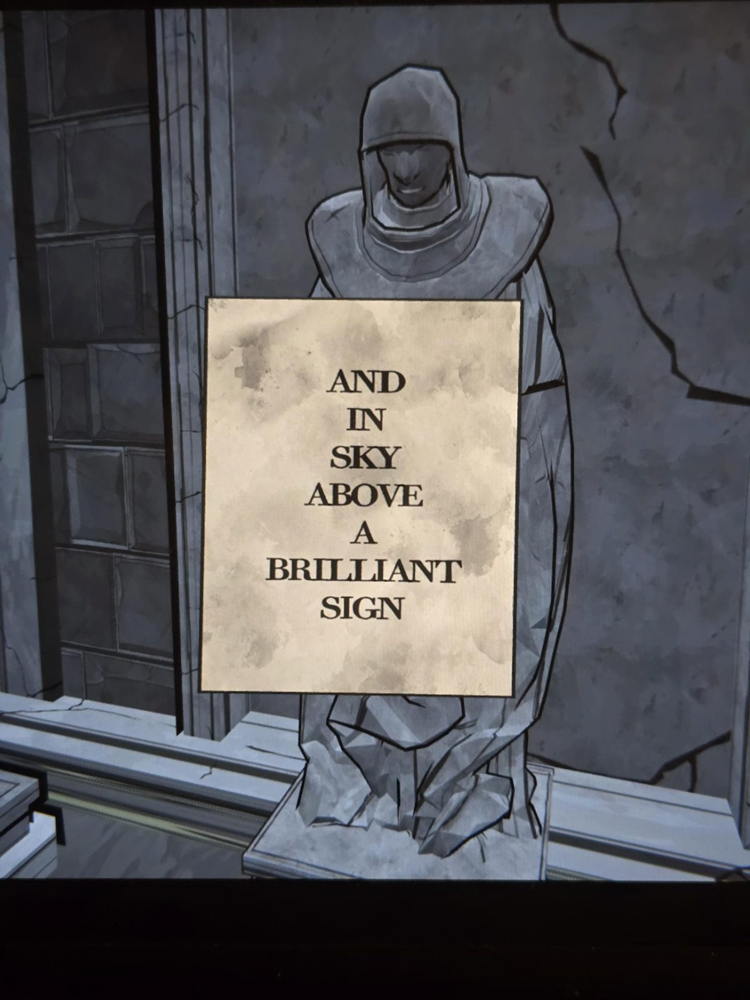

# Записки статуй (Unknown)
Пять статуй, каждая держит [коробку Mora Jai](../../../../puzzles/mora-jai/unknown/ru.md); в каждой коробке вместо Allowance Token лежала записка. Вместе записки читаются как стих (порядок строк по рифме и порядку фото).

1. **В Ариес-Корте, где Король теперь покоится** (In Aries Court where the King now lays)
2. **В священный час та истёртая фраза** (On the sacred hour that timeworn phrase)
3. **Придёт ли юноша с пустыми руками** (Will a youth approach with empty arms)
4. **Без даров, ни золота, ни манерных чар** (Without gifts nor gold nor mannered charms)
5. **И в небе над ним яркий знак** (And in sky above a brilliant sign)

## Заметка
- Рифмы: lays / phrase, arms / charms; у последней строки (sign) пары в этих пяти записках нет.
- «Sacred hour» совпадает с «SACRED» из стиха про лебедя в [Clock Tower](../../../clock-tower/docs/swan-crow-poem/ru.md) (там «sacred hour» предположительно 13:30; это прежняя догадка, связь с этим стихом моя).

## Photos / Фото
01–05 — записки по порядку строк.

    
