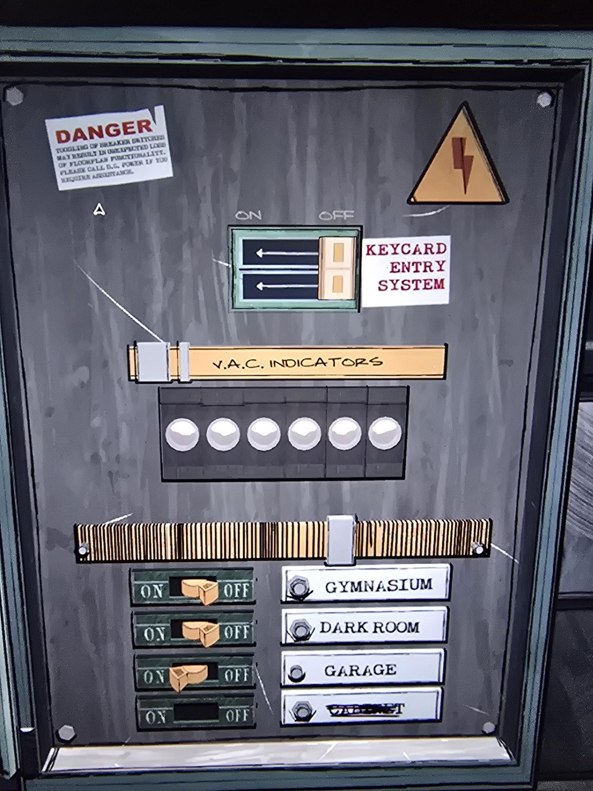

# Щиток в Utility Closet
Щиток DCPOWER в Utility Closet.

*Наклейка:* **ОПАСНО** — переключение автоматов может привести к неожиданной потере функций планов комнат. Если нужна помощь, звоните в D.C. Power.

- Двойной рубильник **KEYCARD ENTRY SYSTEM** (система входа по ключ-картам), ON/OFF.
- **V.A.C. INDICATORS** — шесть круглых индикаторов (загадка, см. [решение](../../solutions.md)).
- Автоматы ON/OFF: **GYMNASIUM**, **DARK ROOM**, **GARAGE**, четвёртый — с зачёркнутой подписью (CABINET?).

## Заметка
- Выключение Keycard Entry System, видимо, открывает двери с ключ-картами. Автоматы включают/выключают свет и питание в комнатах (Garage — ворота, Dark Room — освещение).

## Photos / Фото

