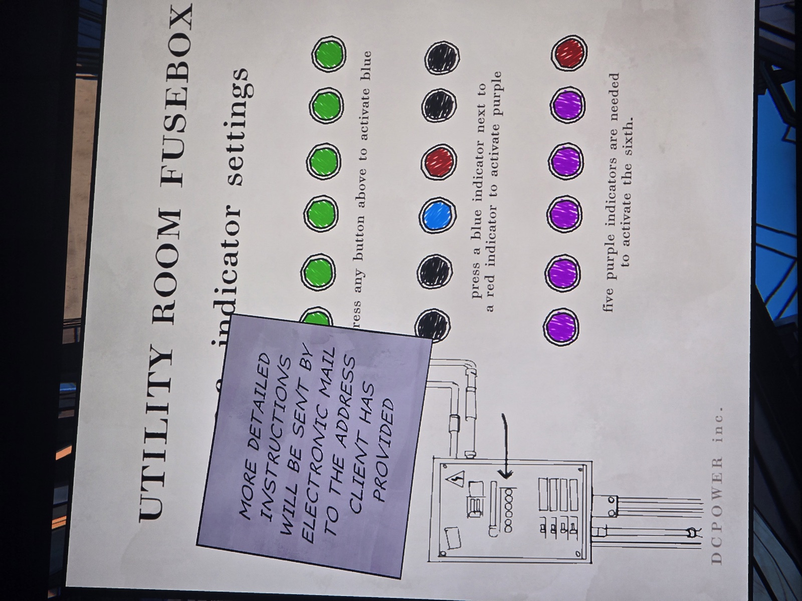

UTILITY ROOM FUSEBOX — [V.A.C.] indicator settings

Row 1 (six green): "[P]ress any button above to activate blue"
Row 2 (black, black, BLUE, RED, black, black): "press a blue indicator next to a red indicator to activate purple"
Row 3 (purple ×5, red): "five purple indicators are needed to activate the sixth."

Sticky note: MORE DETAILED INSTRUCTIONS WILL BE SENT BY ELECTRONIC MAIL TO THE ADDRESS CLIENT HAS PROVIDED

DCPOWER inc. (drawing of the fusebox with an arrow to the row of 6 indicators)

## Photos / Фото

