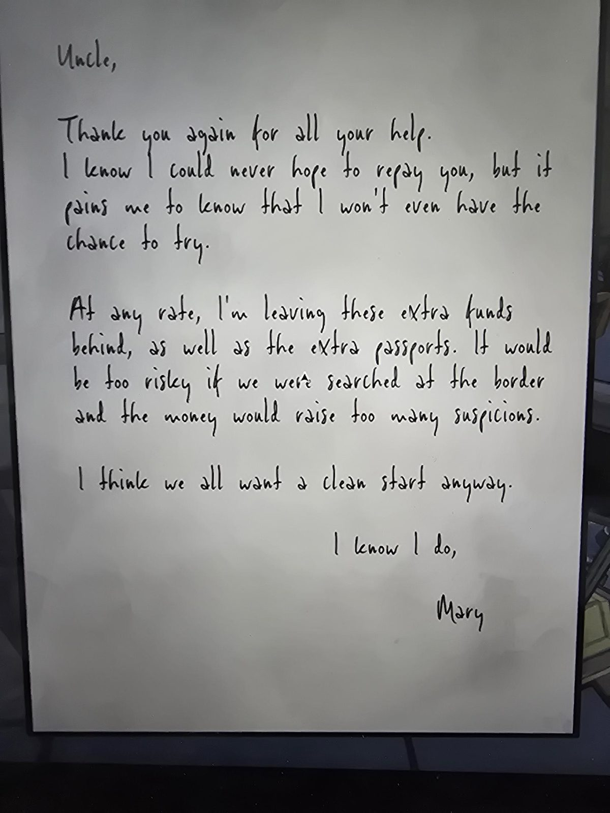

# Записка Мэри дяде: оставленные деньги и паспорта
Vault, ячейка **370**. Рукописная записка чёрными чернилами на белой бумаге, подпись **Mary**.

«Дядя, ещё раз спасибо за всю помощь. Знаю, что никогда не смогу тебе отплатить, но мне больно знать, что у меня даже не будет шанса попытаться. В любом случае я оставляю эти **лишние деньги**, а также **лишние паспорта**. Было бы слишком рискованно, если бы нас обыскали на границе, а деньги вызвали бы слишком много подозрений. Думаю, мы все всё равно хотим **начать с чистого листа**. Я-то точно хочу. — **Мэри**»

## Заметка
- Контекст: [красное письмо №5](../../../drafting-studio/docs/red-letter-5-mary/ru.md) (Мэри уходит через границу) и [письмо Мэри в Safehouse](../../../abandoned-mine/safehouse/docs/mary-letter-six-months/ru.md).
- «Лишние паспорта», вероятно, паспорта из ячеек этого хранилища: [Джин Риббон](../passport-jean-ribbon/ru.md) и [Саманты Хейс](../passport-samantha-hayes/ru.md) (вывод, не из текста).

## Photos / Фото

