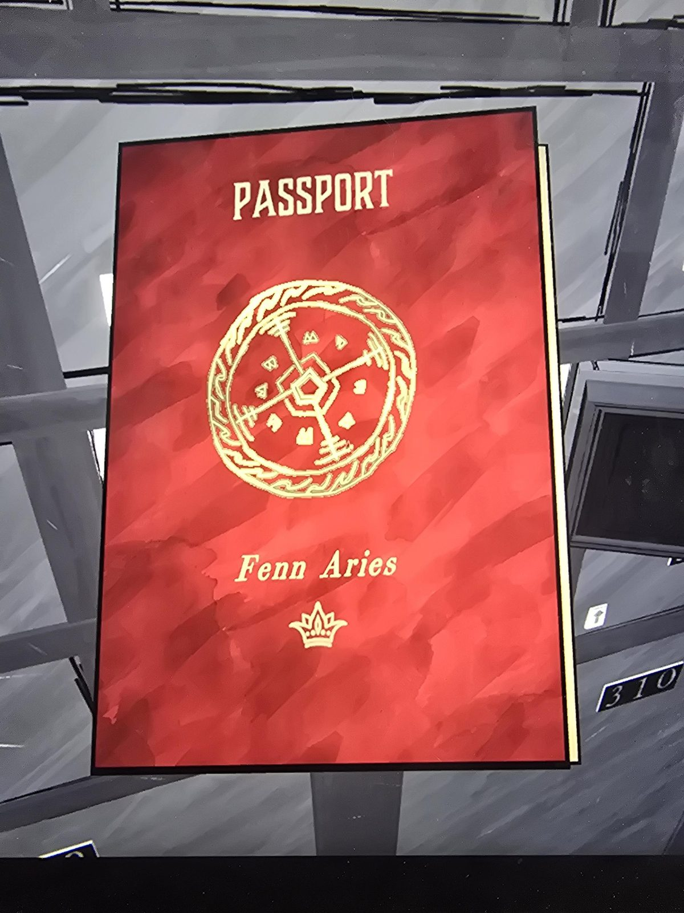
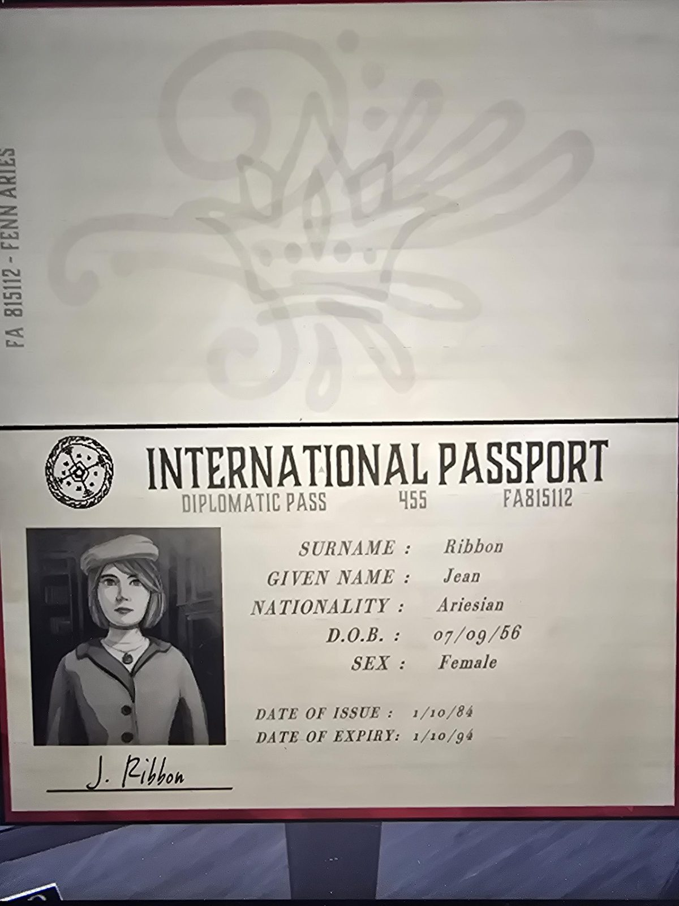

# Паспорт Джин Риббон (Vault, ячейка 304)
Лежал в ячейке **304** в [Vault](../../solutions.md); ячейка открыта [ключом 304](../../../../items/deposit-box-key-304/ru.md).

**Обложка:** красный паспорт королевства **Fenn Aries** (круглая печать с пятиугольным ядром и четырьмя лучами, внизу маленькая корона).

**Внутри:** международный паспорт, дипломатический (Diplomatic Pass 455, № **FA815112**).
- Фамилия: **Ribbon**, имя: **Jean** (Джин Риббон).
- Гражданство: Ariesian.
- Дата рождения: 07.09.56. Пол: женский.
- Выдан 10.01.84, действителен до 10.01.94 (формат даты как в игре: 1/10/84).
- Подпись: J. Ribbon. На фото женщина в берете и жакете, на шее подвеска.

Имя Jean Ribbon встречается в [руководстве насосной системы](../../../library/books/epcw-pump-system-user-manual/ru.md).

## Заметка
- Фото обложки (печать Fenn Aries) стало подсказкой к загадке [Inner Sanctum 2](../../../the-underpass/inner-sanctum-2/solutions.md).

## Photos / Фото
 
