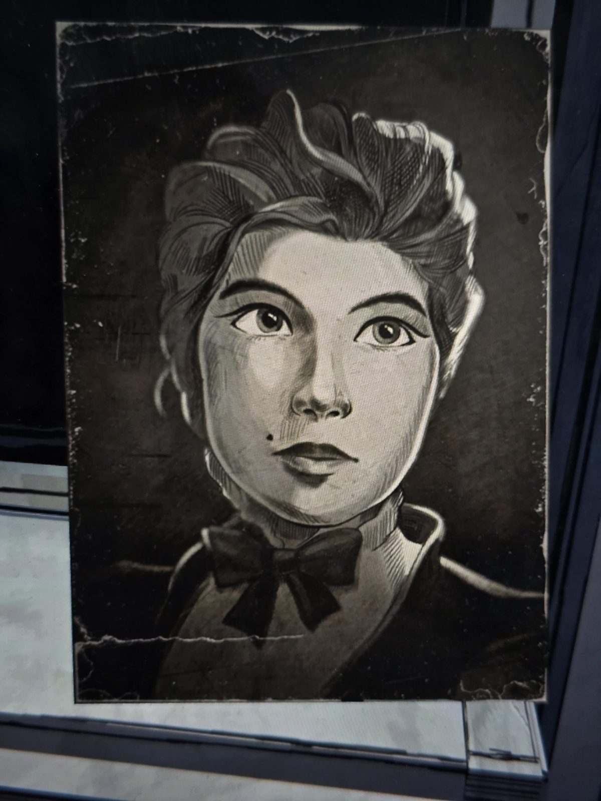

# Старая фотография: девушка с родинкой
Потёртое фото в Walk-in Closet, без подписи. Молодая женщина с убранными наверх волосами, **родинка** у рта, высокий воротник с тёмным бантом (по виду конец XIX – начало XX века).

## Заметка
- Кто она, неизвестно. Родинка — примета для опознания на других портретах.

## Photos / Фото

