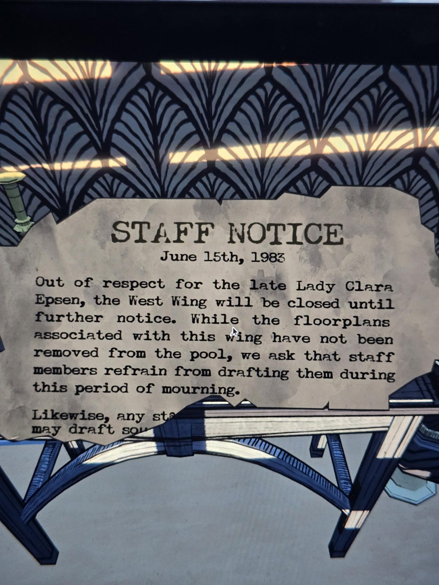

# Объявление для персонала: западное крыло закрыто (15.06.1983)
Порванный лист в West Wing Hall.

**ОБЪЯВЛЕНИЕ ДЛЯ ПЕРСОНАЛА**
15 июня 1983 г.

Из уважения к покойной **леди Кларе Эпсен** **западное крыло** закрыто до дальнейшего уведомления. Хотя планы комнат этого крыла не убраны из пула, просим персонал воздерживаться от их выбора (drafting) в период траура.

Точно так же, любой сотру… *(оторвано)*
может выбирать… *(оторвано)*

## Заметка
- Первая точная дата с годом: **15 июня 1983**.
- **Леди Клара Эпсен** умерла незадолго до этого. Ср. в `old` упоминание «Clara & Simon, Inneclipse Ball 1952» — возможно, жена Саймона-старшего (сверить, когда найдётся новое фото).
- Объясняет, почему в западном крыле двери чаще заперты (табличка в Hallway).
- Низ листа оторван/закрыт; если удастся, снять полностью.

## Photos / Фото

