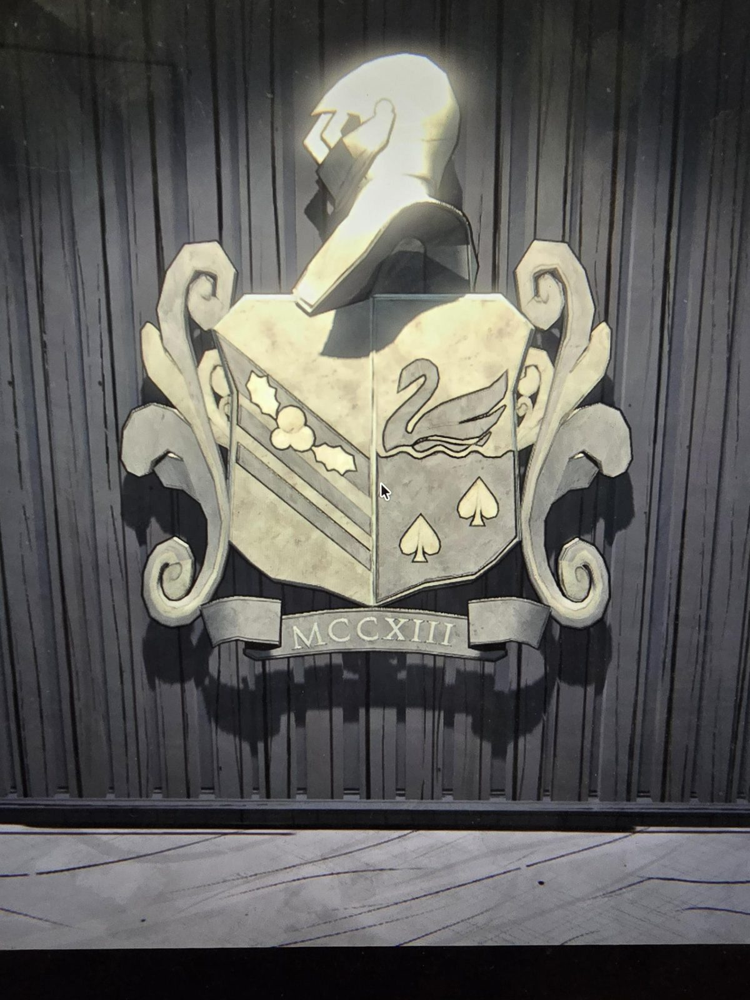

Coat of arms on a wood-panelled wall: a helmet above a split shield, scrollwork on both sides.

Left half: holly leaves and berries on a diagonal band.
Right half: a swan above water, two spades below.

Banner: MCCXIII

## Photos / Фото

