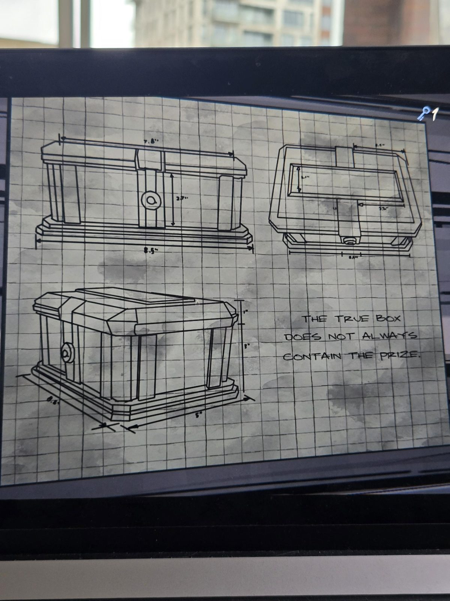

# Чертёж шкатулки: «Правдивая коробка»
Чертёж на клетчатой бумаге в Workshop: шкатулка с замком в трёх проекциях, с размерами.

**ПРАВДИВАЯ КОРОБКА НЕ ВСЕГДА СОДЕРЖИТ ПРИЗ.**

## Заметка
- Подсказка к игре с тремя коробками в [Parlor](../../../parlor/docs/lowry-three-boxes-letter/ru.md): коробка, на которой написана правда, не обязательно та, где приз.

## Photos / Фото

