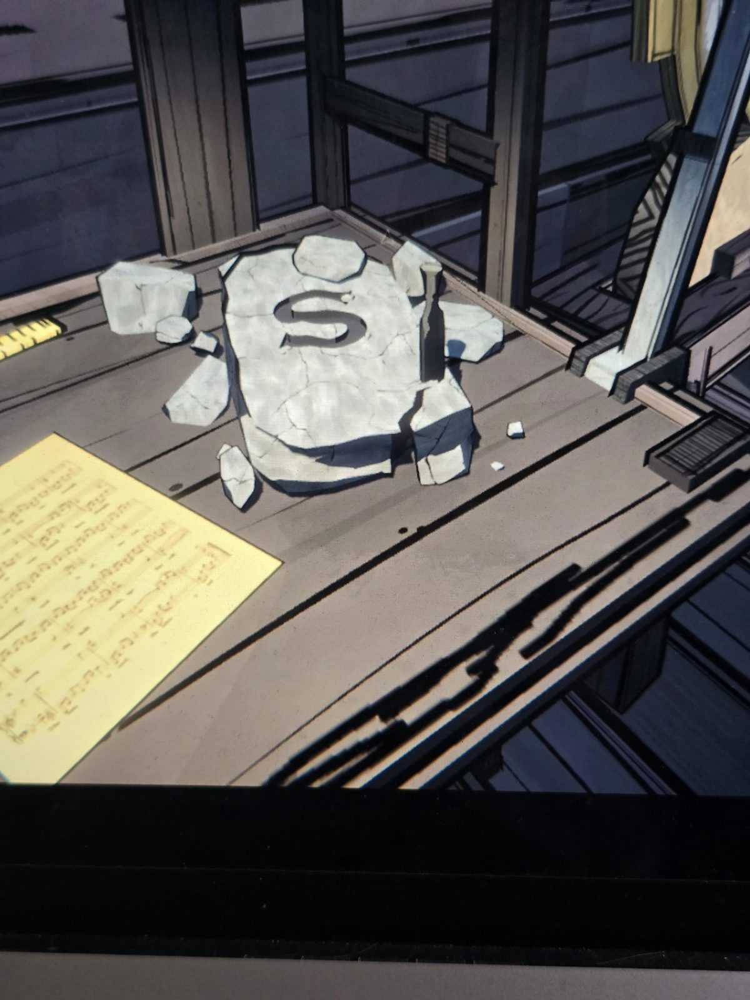

# Камень с буквой S
Каменный блок на верстаке в Workshop, вырезана буква **S**, рядом зубило и осколки. Рядом лежит лист нот.

## Заметка
- Буква совпадает с буквой клетки 6.5 из [загадки картин](../../../../puzzles/picture-letters/README.md) (COAST / COAT = S). Workshop показывает букву своей клетки на камне.
- Ср. ноты №8: «Stones cut by hand, and letters wrought».

## Photos / Фото

