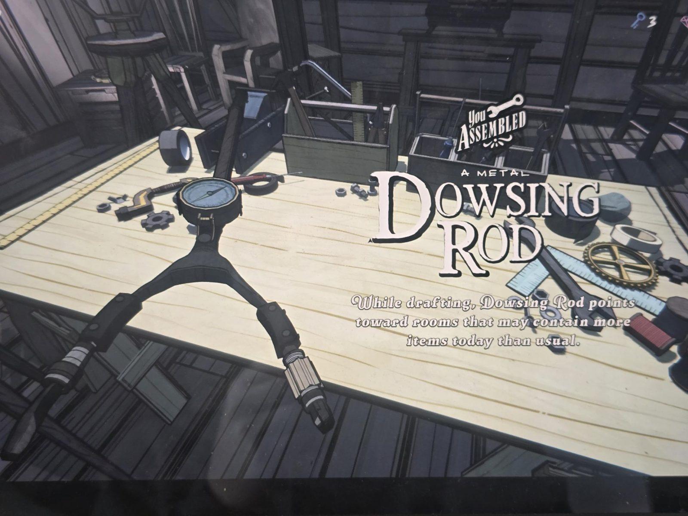

# Рецепт Workshop: Dowsing Rod
Dowsing Rod («A metal Dowsing Rod») собирается из [Shovel](../../../../items/shovel/ru.md) и [Compass](../../../../items/compass/ru.md) (см. [записку](../workshop-idea-compass-shovel/ru.md)).

При выборе комнат (drafting) указывает в сторону комнат, где сегодня может оказаться больше предметов, чем обычно.

## Photos / Фото

