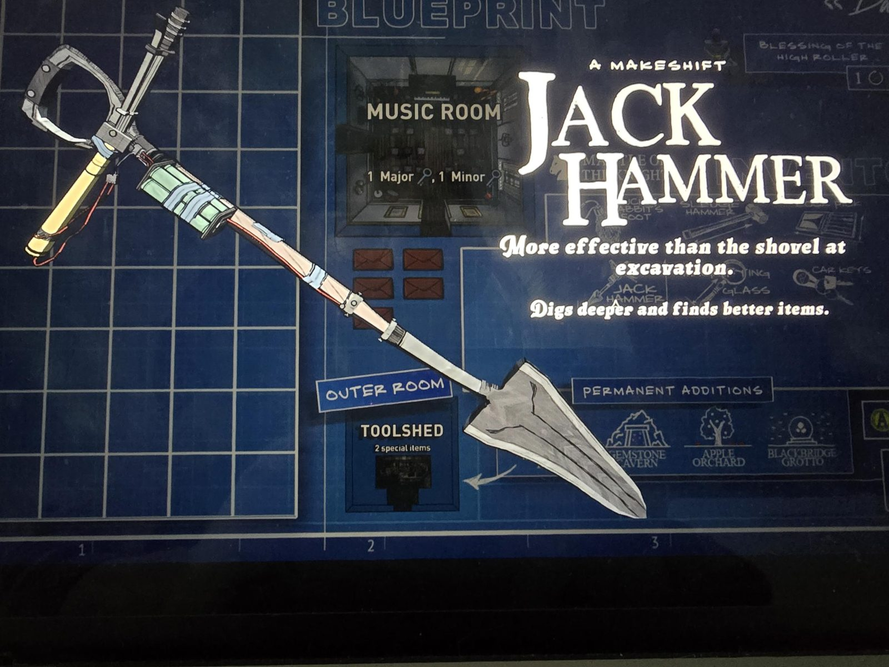
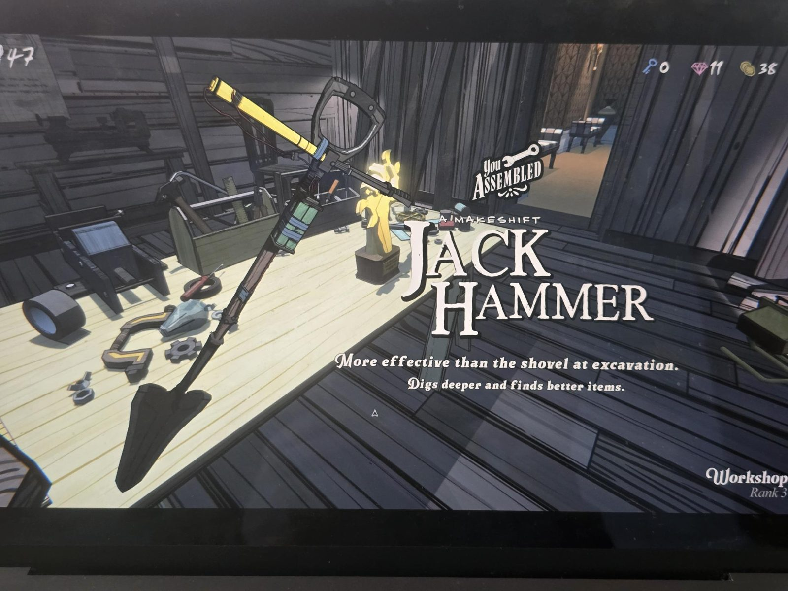

# Рецепт Workshop: Jack Hammer
Jack Hammer («A makeshift Jack Hammer») собирается из [Shovel](../../../../items/shovel/ru.md), рычага и батареи.

Эффективнее лопаты при раскопках: копает глубже и находит лучшие предметы.

Собран в Workshop на Rank 3 («You assembled a makeshift Jack Hammer»). Это последнее из 8 устройств: за него выдан [Trophy of Invention](../trophy-of-invention/ru.md).

## Photos / Фото
 
