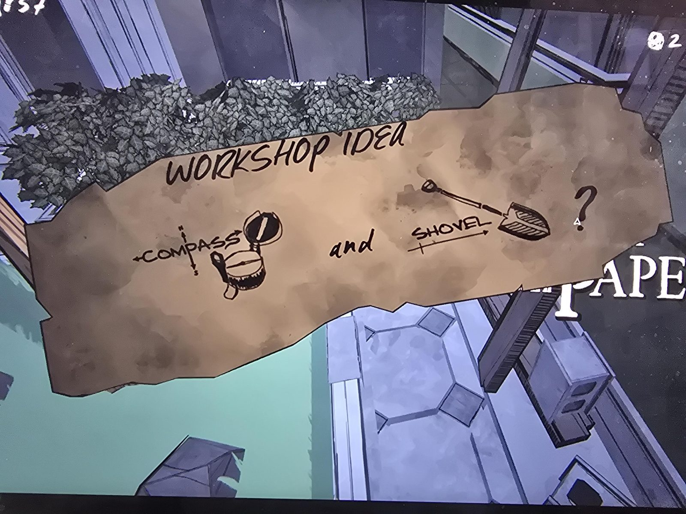

# Заметка «Workshop idea»: компас и лопата
Workshop. Обрывок бумаги с рукописной надписью **«WORKSHOP IDEA»**: слева компас (**COMPASS**, оси N/S и стрелка размера), справа **«and»** и лопата (**SHOVEL**, стрелка размера), в конце знак вопроса.

## Инструкция
Собрать в Workshop из [Compass](../../../../items/compass/ru.md) и [Shovel](../../../../items/shovel/ru.md). Результат на записке не указан («?»).

## Photos / Фото

