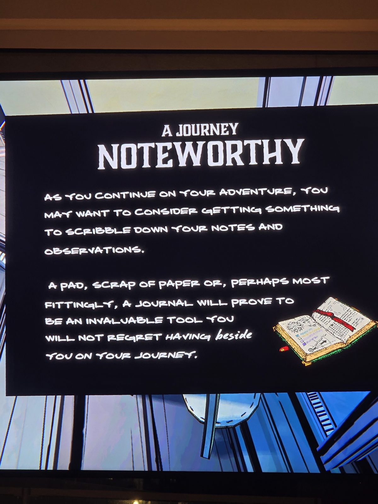
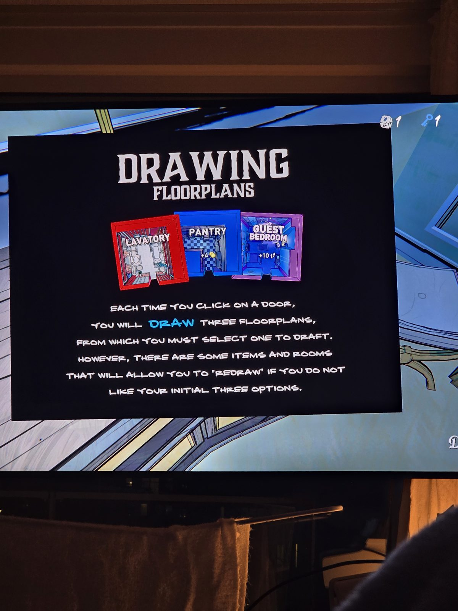
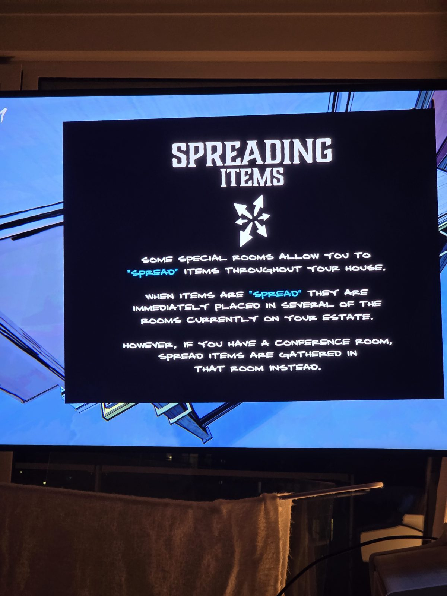
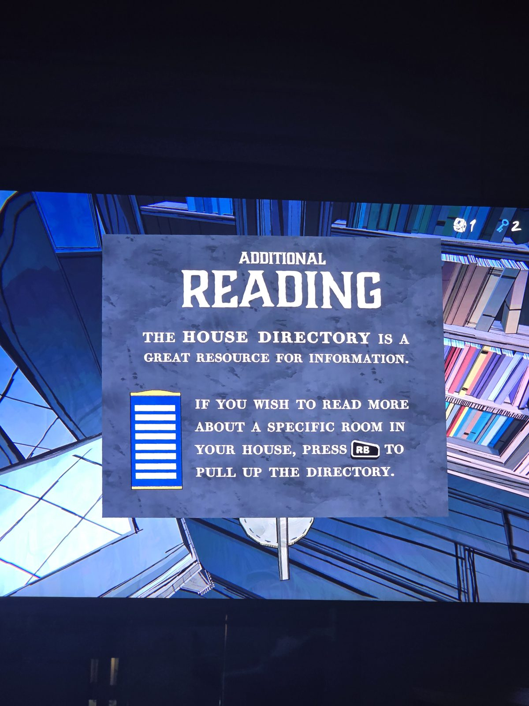
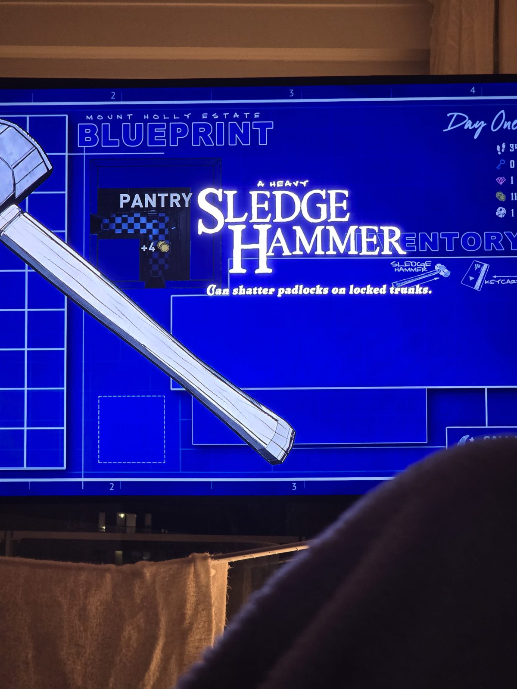

# Обучающие карточки игры
01. **A Journey Noteworthy:** стоит вести блокнот для заметок и наблюдений.
02. **Drawing Floorplans:** при каждом клике по двери тянешь три чертежа и выбираешь один; некоторые предметы и комнаты позволяют перевытянуть (REDRAW).
03. **Spreading Items:** особые комнаты разбрасывают предметы по дому; с Conference Room разбросанные предметы собираются там.
04. **Additional Reading:** House Directory (кнопка RB) содержит информацию о каждой комнате.
05. **Sledge Hammer:** сбивает навесные замки с запертых сундуков.

## Photos / Фото

